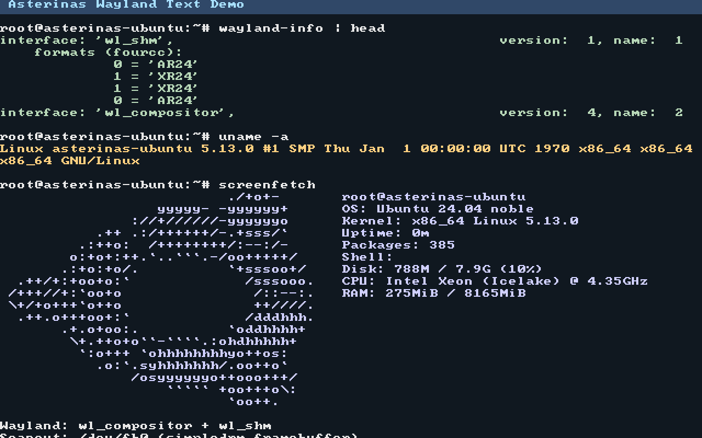

# Wayland on the Asterinas Ubuntu Rootfs

This document records how to enable the Wayland text demo on the Ubuntu
rootfs, what was tested, how it works, and which limitations remain.

The working demo is intentionally small: a minimal Wayland compositor and a
`wl_shm` client render terminal-style text directly to the simpledrm
framebuffer. It is not a full desktop or an interactive terminal emulator.



## Quick Start

### 1. Build the Ubuntu graphical rootfs

The existing Ubuntu rootfs build script can install the graphical userspace
packages. It must run as root inside the development container because the
package maintainer scripts need `/dev`, `/proc`, and `/sys`.

```bash
sudo bash distro/ubuntu/build.sh \
    --tarball ubuntu-base-24.04.5-base-amd64.tar.gz \
    --output test/initramfs/build/ubuntu-wayland.img \
    --size 8G \
    --with-systemd \
    --with-gui
```

`--with-gui` installs Weston, cage, weston-terminal, `wayland-utils`,
`screenfetch`, fonts, Xorg fallback packages, and their runtime dependencies.

### 2. Build the Wayland demo binaries

The demo binaries are not package-managed. Build them on an Ubuntu 24.04
host or in the development container:

```bash
sudo apt-get install build-essential libdrm-dev libwayland-dev \
    wayland-protocols
bash test/wayland/build.sh
```

Copy the binaries into the rootfs staging directory or into a mounted rootfs
image:

```text
test/wayland/bin/wl-text-compositor  -> /usr/local/bin/
test/wayland/bin/wl-text-client      -> /usr/local/bin/
test/wayland/bin/drm-info            -> /usr/local/bin/
test/wayland/bin/drm-pageflip        -> /usr/local/bin/
test/wayland/bin/fb-colorbar         -> /usr/local/bin/
test/wayland/bin/wl-colorbar         -> /usr/local/bin/
```

### 3. Boot with the EFI framebuffer

The framebuffer console and simpledrm need the EFI handover boot protocol.
With the default `grub-rescue-iso`/multiboot2 path GRUB reports
`error: no suitable video mode found`, and `/dev/fb0` and `/dev/dri/card0`
are absent.

```bash
make UBUNTU_ROOTFS=1 \
    UBUNTU_ROOTFS_IMAGE=$PWD/test/initramfs/build/ubuntu-wayland.img \
    BOOT_PROTOCOL=linux-efi-handover64 \
    QEMU_QMP_SOCKET=$PWD/test-artifacts/qmp.sock \
    QEMU_DISPLAY=vnc=127.0.0.1:42 \
    run_kernel
```

The EFI stub should report:

```text
[EFI stub] Found the framebuffer at 0x80000000 with 1280x800 pixels
```

The image enables `asterinas-wltext.service` by default, so the minimal
Wayland text session starts automatically after `multi-user.target`.

### 4. Start the session manually

If the service is not enabled, run the compositor and client from a root
shell:

```bash
export XDG_RUNTIME_DIR=/run/user/0
mkdir -p "$XDG_RUNTIME_DIR"
chmod 700 "$XDG_RUNTIME_DIR"

/usr/local/bin/wl-text-compositor &
WAYLAND_DISPLAY=wayland-0 /usr/local/bin/wl-text-client
```

The client prints `WAYLAND-TEXT-CLIENT: READY`, then keeps the rendered text
on screen for 10 minutes.

### 5. Capture the QEMU screen

The QMP socket configured above can capture the VGA scanout:

```bash
python3 tools/qemu_capture.py \
    --socket test-artifacts/qmp.sock \
    --output test-artifacts/wayland-text.png
```

The script writes a PPM and a PNG and can assert sampled pixel colors with
`--expect X,Y,RRGGBB`.

## Test Results

### DRM page flip

The standalone `drm-pageflip` test uses two dumb buffers:

1. `SETCRTC` a red buffer.
2. `PAGE_FLIP` to a green buffer with `DRM_MODE_PAGE_FLIP_EVENT`.
3. `poll` and `read` until `DRM_EVENT_FLIP_COMPLETE`.

Result:

```text
DRM-TEST: connector=19 crtc=15 mode=1280x800
DRM-TEST: RED
DRM-TEST: PAGE-FLIP-REQUESTED
DRM-TEST: FLIP-COMPLETE user_data=0x1234
DRM-TEST: GREEN
DRM-TEST: PASS
```

Screenshots:

- [Red scanout](test/wayland/screenshots/drm-pageflip-red.png)
- [Green scanout](test/wayland/screenshots/drm-pageflip-green.png)

### Wayland globals

`wayland-info` sees the expected minimal globals:

```text
interface: 'wl_shm', version: 1
interface: 'wl_compositor', version: 4
```

### Terminal text output

The final client output includes the real `uname -a` output and screenfetch:

```text
Linux asterinas-ubuntu 5.13.0 #1 SMP ... x86_64 GNU/Linux

OS: Ubuntu 24.04 noble
Kernel: x86_64 Linux 5.13.0
Uptime: 0m
Packages: 385
Shell:
Disk: 788M / 7.9G (10%)
CPU: Intel Xeon (Icelake) @ 4.35GHz
RAM: 275MiB / 8165MiB
```

Final screenshot:

- [wayland-text-final.png](test/wayland/screenshots/wayland-text-final.png)

## Implementation

### Kernel-side DRM changes

The following changes are required for the DRM path used by the native
compositor experiments:

- `kernel/comps/drm/src/ioctl/kms.rs`
  - `DRM_IOCTL_MODE_PAGE_FLIP` with `FLIP_COMPLETE` events.
  - No-op legacy cursor ioctls so compositors can finish an output commit
    when simpledrm has no cursor plane.
- `kernel/comps/drm/src/file.rs`
  - Per-open event queue, `read_at`, and `Pollable`.
- `kernel/core/src/process/signal/poll.rs`
  - `Pollee` is public so the DRM component can wake pollers.
- `kernel/comps/simpledrm/src/lib.rs`
  - Publishes the boot framebuffer's active CRTC/encoder/connector state.
- `kernel/comps/drm/src/kms/mod.rs`
  - `set_initial_enabled_mode` for the firmware framebuffer.

### Minimal Wayland compositor

`test/wayland/wl-text-compositor.c` implements only:

- `wl_compositor`, `wl_surface`, `wl_region`;
- `wl_shm` through `wl_display_init_shm`;
- `wl_callback` frame completion;
- scanout by copying the committed `wl_shm` buffer to `/dev/fb0`.

There is no shell role, seat, input, DRM object, or GPU rendering. A client
surface without a shell role is sufficient for this demo because the
compositor handles every commit as a full-screen frame.

### Text client

`test/wayland/wl-text-client.c`:

- creates a full-screen `wl_shm` buffer;
- renders ASCII with the kernel's `font8x8` glyphs at 2x scale;
- runs `wayland-info`, `uname -a`, and `screenfetch` through `popen`;
- strips ANSI CSI/OSC sequences and replaces non-ASCII block art with `#`;
- commits one frame and sleeps, leaving the text visible for screenshots.

## Why the Native cage/wlroots Path Is Not Used

The native path was brought up as far as:

- cage finds `/dev/dri/card0` and `Virtual-1`;
- it reads `1280x800 @ 60Hz`;
- `drmModeSetCrtc` and page flips succeed;
- the terminal client maps and starts.

It then hangs during the first client frame. Instrumenting
`wlr_scene_output_commit()` narrowed the hang to the full-screen fill of the
scanout buffer. Replacing pixman with a direct CPU fill still hangs at the
same point, so the problem is in writing the DRM GEM dumb-buffer mapping,
not in Wayland or the page-flip path.

The `wl-text` demo avoids that kernel issue by scanning out through
`/dev/fb0` instead of a DRM dumb buffer. It still uses the Wayland protocol
for compositor/client communication.

## Files

| Path | Purpose |
|---|---|
| `test/wayland/wl-text-compositor.c` | Minimal fbdev-backed Wayland compositor |
| `test/wayland/wl-text-client.c` | `wl_shm` terminal-text client |
| `test/wayland/font8x8_basic.h` | 8x8 ASCII glyphs |
| `test/wayland/drm-info.c` | DRM topology probe |
| `test/wayland/drm-pageflip.c` | Page-flip/event regression test |
| `test/wayland/fb-colorbar.c` | `/dev/fb0` color-bar probe |
| `test/wayland/wl-colorbar.c` | Deterministic `wl_shm` color-bar client |
| `test/wayland/build.sh` | Builds all probes and demo binaries |
| `test/wayland/screenshots/` | Preserved test screenshots |
| `tools/qemu_capture.py` | QMP screenshot and pixel assertion helper |
| `distro/ubuntu/overlay/etc/asterinas/wltext-session.sh` | Session launcher |
| `distro/ubuntu/overlay/etc/systemd/system/asterinas-wltext.service` | Systemd unit |

## Limitations

- The demo renders a fixed frame; it is not an interactive terminal.
- There is no keyboard, seat, pty, or shell integration.
- The client renders ASCII only; the screenfetch logo is approximated with
  `#` characters.
- Native cage/wlroots DRM scanout remains blocked by the GEM dumb-buffer
  write issue described above.
- Xorg is installed for fallback experiments, but the minimal Wayland demo
  does not use it.
